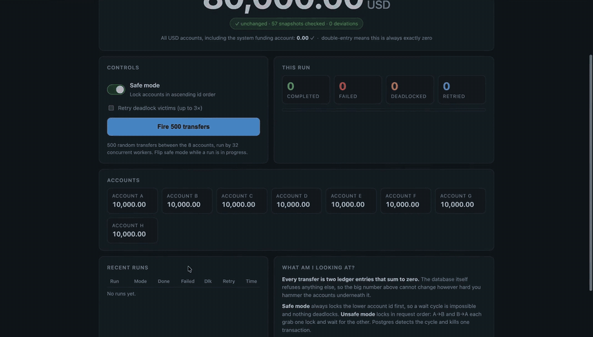
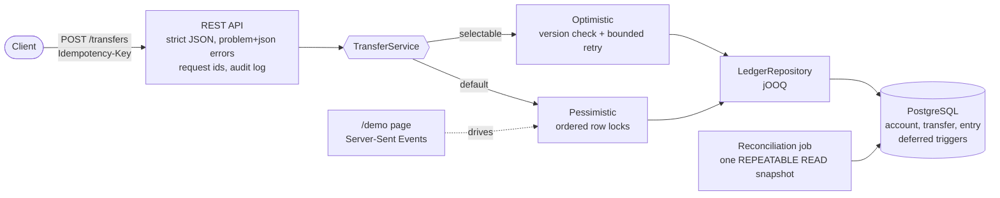
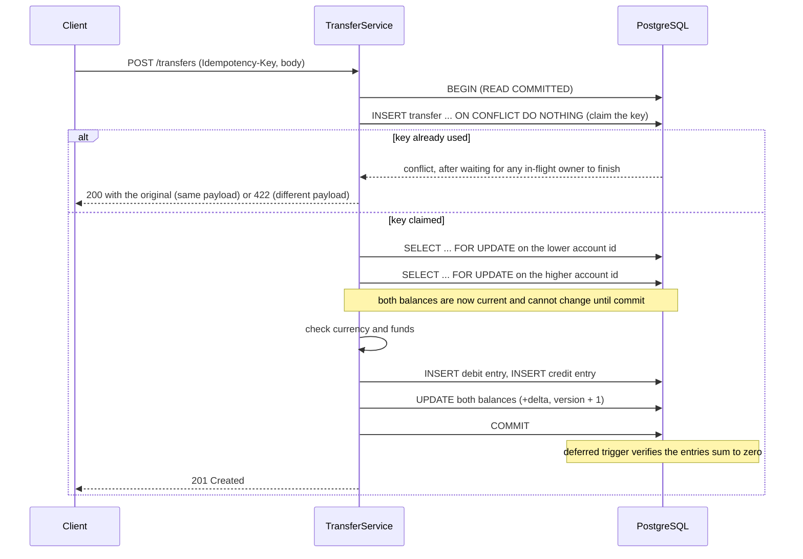
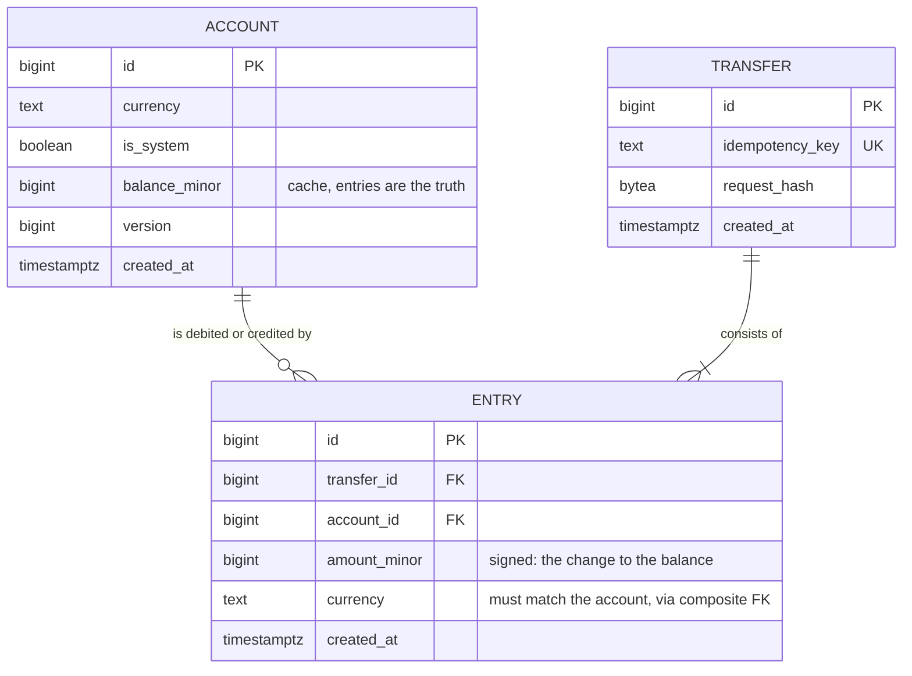

<p align="center">
  
</p>

# Ledger

<!-- Replace YOUR_GITHUB_USERNAME with the GitHub account that owns this repository. -->
[](https://github.com/YOUR_GITHUB_USERNAME/Ledger/actions/workflows/ci.yml)


When you send money through a bank or a fintech app, one small piece of software underneath has to get one thing
right: **the books must balance**. Every cent that leaves one account must arrive in another. A payment must not be
applied twice because your phone retried after a bad connection. And a thousand payments hitting the same account at
the same instant must not lose, or invent, a single penny. This project is that piece, built as a service: a
**double-entry ledger on PostgreSQL**. It is not a bank; it is the correctness core that sits underneath one.

The demo above fires hundreds of simultaneous transfers while the total across the accounts stays frozen. One switch
reintroduces a classic concurrency bug *on purpose*, so you can watch transfers die from deadlocks in real time while
the money still never goes missing, and flip it back to see them stop.

**Contents:** [Try it](#try-it) · [What it guarantees](#what-it-guarantees) · [Architecture](#architecture) ·
[Design decisions](#design-decisions-and-the-alternatives-i-rejected) · [Benchmark](#benchmark-pessimistic-vs-optimistic) ·
[Testing](#how-it-is-tested) · [API](#api) · [Configuration](#configuration) · [Limitations](#known-limitations) ·
[Where to start reading](#where-to-start-reading)

---

## Try it

You need JDK 21 and Docker. (Docker is needed to *build*, not just to run: see [why](#build-time-code-generation).)

```bash
./mvnw -DskipTests package && docker compose up --build
# then open http://localhost:8080/demo
```

Press **Fire 500 transfers**. Switch **Safe mode** off and fire again. Switch it back on mid-run.

Other ways to run it:

```bash
docker compose up -d db                                   # just the database, on localhost:5432
./mvnw spring-boot:run -Dspring-boot.run.profiles=demo    # the app, with the demo page
./mvnw verify                                             # the full test suite (needs Docker)
./mvnw verify -Pbenchmark                                 # the contention benchmark (about 6 minutes)
```

The `demo` profile exposes `/demo` and the switch that makes the demo's transfers deadlock on purpose. The switch
lives on the demo's own `TransferService` instance; the one behind `/transfers` has no switch, so even with the demo on,
API traffic always locks in order (a test hammers the API with opposite transfers while the demo is unsafe and requires
zero failures). Without the profile, `/demo` and the switch are 404 and no switch object exists at all. Add `json` to the profiles
(`demo,json`) for structured JSON logs.

---

## What it guarantees

| Guarantee | How | Where it is proved |
|---|---|---|
| **No money is created or destroyed.** Every transfer is two or more entries in one currency that sum to zero. | Deferred constraint triggers *in the database*, on both `entry` and `transfer`. | [`SchemaConstraintsTest`](src/test/java/com/ardakeles/ledger/SchemaConstraintsTest.java): raw SQL that bypasses all application code. |
| **The cached balance always equals the sum of entries.** Entries are the source of truth. | A reconciliation job recomputes every balance from the entries, in one snapshot. | [`ReconciliationTest`](src/test/java/com/ardakeles/ledger/reconciliation/ReconciliationTest.java), and every report is clean under live load. |
| **No overdraft.** | The funds check runs on a row-locked, current balance; a `CHECK` constraint is the backstop. | The scarce-funds run: every rejection is a clean `INSUFFICIENT_FUNDS`, never a constraint error. |
| **A retried request never posts twice.** | The idempotency key is claimed first with `INSERT ... ON CONFLICT DO NOTHING`. | [`IdempotencyContract`](src/test/java/com/ardakeles/ledger/service/IdempotencyContract.java), including concurrent duplicates. |
| **Concurrent transfers neither deadlock nor lose updates.** | Row locks taken in ascending account id order. | 10,000 transfers on 20 threads; plus a negative control that must deadlock. |
| **A failure leaves nothing behind.** | One transaction per transfer; a victim rolls back completely. | Every load test asserts exactly the reported transfers exist, each with two entries. |
| **Input cannot smuggle in money.** | Strict JSON (no float-to-int, no string coercion, no unknown fields); system accounts are unreachable from the API. | [`ApiTest`](src/test/java/com/ardakeles/ledger/api/ApiTest.java). |

---

## Architecture



**One transfer, in order** (the order of these steps is the design):



**Schema** (three tables; amounts are `BIGINT` minor units, never floats):



---

## Design decisions, and the alternatives I rejected

### Money and the schema

- **`BIGINT` minor units, no floats or decimals anywhere.** Integers are exact and cannot drift. A currency allowlist
  (USD, EUR, GBP, TRY) keeps "minor unit" meaning one hundredth everywhere; JPY (0 decimals) or BHD (3) would need a
  per-currency exponent, which v1 deliberately does not have.
- **`entry` is the source of truth; `account.balance_minor` is a cache.** Without the cache, every balance read and
  overdraft check would sum the whole entry history, and there would be no row to lock. With it, correctness rests on
  keeping two things in step, which is exactly what the reconciliation job proves.
- **The cache is maintained by the application, not by a trigger.** A trigger would write balances in entry-insertion
  order, silently taking lock ordering out of the application's hands, and would make reconciliation trivially pass.
- **Entries and transfers are append-only** (triggers reject `UPDATE`/`DELETE`). A correction is a new, reversing
  transfer. History is never rewritten.
- **A composite foreign key** `(account_id, currency) -> account(id, currency)` makes the database refuse an entry whose
  currency differs from its account's. The "one currency per transfer" trigger alone would accept two EUR entries on two
  USD accounts.

### Rules live in the database

The "entries sum to zero" rule is a **deferred constraint trigger**, not Java. Application checks can be bypassed by
another service, a script or a bug; database constraints cannot (see [limitations](#known-limitations) for the one
caveat). Two details are easy to get wrong:

- **Deferred**, because entries are inserted one at a time. An immediate trigger would fire after the first insert, see
  a lone non-zero entry, and reject every valid transfer. Deferring runs the check at `COMMIT`, when all entries exist.
- **Attached to both `entry` and `transfer`.** A row trigger cannot fire on rows that do not exist: a transfer written
  with *no* entries would never fire an entry-only trigger. Conversely, a stray entry appended to an already-committed
  transfer never fires a transfer-only trigger. Each covers the other's blind spot. (I confirmed this by removing the
  entry-side trigger: exactly the stray-entry test failed.)

### Idempotency

The client sends an `Idempotency-Key`. Same key and same payload returns the original with `200`; same key and a
*different* payload is `422` (a client bug). The transfer row is inserted **first**, with `ON CONFLICT DO NOTHING`:

| Approach | Verdict |
|---|---|
| Check for the key, then insert | **Rejected.** Racy: two concurrent requests both see "absent". This passes every sequential test and fails only under real concurrency (verified by mutation). |
| Insert and catch the unique violation | **Rejected.** In Postgres a unique violation aborts the whole transaction, so the loser must roll back and re-read in a new one. |
| **`INSERT ... ON CONFLICT DO NOTHING`, claim first** | **Chosen.** No error is raised, so the transaction stays usable. A concurrent duplicate *blocks* on the unique index until the owner finishes: if the owner commits, the duplicate replays; if it rolls back, the duplicate executes itself. A failed attempt does not burn the key. |

Claiming first also means a duplicate waits holding no account locks, so it can never be part of a deadlock cycle. The
request hash is SHA-256 of the *parsed* fields, not the raw body, so whitespace or key order cannot cause a false `422`.

### Concurrency: ordered row locks

Two opposite transfers, A to B and B to A, deadlock if each locks its own source first: each holds one lock and waits for
the other. The fix is a **total order**: always lock the lower account id first. A wait cycle would need a transaction
holding a higher id while waiting for a lower one, which cannot happen if everyone acquires in the same order.

- **Why `READ COMMITTED` plus row locks is enough.** `SELECT ... FOR UPDATE` returns the *latest committed* version of the
  row once the lock is acquired, so after it returns the balance is current and cannot change until commit (every writer
  takes the same lock). That makes read-check-write atomic. The invariant is per-row (an account's balance must stay
  non-negative): the decision about account X reads only X and writes only X, and a credit only ever raises a balance. There
  is no cross-row predicate, so no write skew.
- **Why not `SERIALIZABLE`.** It would also be correct, but it works by aborting conflicting transactions (SQLSTATE 40001)
  and making clients retry; on hot rows that is a lot of aborts. Row locks already serialize exactly the conflicting
  transactions and no others.
- **Locks are separate statements, not one `ORDER BY ... FOR UPDATE`.** The order is the one property this project is
  about; I did not want it to depend on how the planner executes a multi-row locking query.
- **Ordering and the lock are separate protections.** With `FOR UPDATE` removed but ordering kept, 10 deadlocks appeared
  (the later `UPDATE`s became the lock order) *and* 306 raw constraint violations (stale funds checks). The lock phase has
  to come first.

The deadlock is also available **on purpose**: with `ledger.demo.enabled=true`, a runtime switch makes the demo's own
`TransferService` instance take locks in request order (the API's instance has no switch). The ledger stays correct even then, because a killed transaction rolls back completely: money is never
created or destroyed, and the transfer simply fails. Ordering buys *liveness*, not correctness.

### An optimistic variant, and why it is not the default

`OptimisticTransferService` reads without locks, decides, then writes each balance with
`UPDATE ... WHERE version = <what I read>`. Zero rows updated means someone changed the account, so the transaction
rolls back and a retry loop *outside* the transaction starts over (full-jitter exponential backoff, a bounded budget of 20
attempts, then a clean `503`). Two things worth knowing:

- **Optimistic does not mean deadlock-free.** The version-checked `UPDATE`s take row locks in the order they run, so they
  must also run in ascending id order. Without that, the optimistic path deadlocked in the test suite.
- **Completion becomes probabilistic.** Under 20-way contention about 1 in 1,000 transfers exhausted a budget of 10; with
  20, about 1 in 10,000 or fewer. The optimistic test contract therefore allows up to 1% to be abandoned, while
  conservation and "nothing partial" still hold exactly. The pessimistic contract demands all 10,000.

### Reconciliation

A scheduled job recomputes every account's balance from its entries and compares it with the cache, and independently
re-verifies every transfer's double-entry rule (so a bypassed trigger would still be caught). It runs in **one read-only
`REPEATABLE READ` transaction**, because every transfer commits its entries and balance updates atomically, a single
snapshot always shows both or neither. Reading balances and entries as separate `READ COMMITTED` queries reported
phantom drift on healthy accounts in my mutation test; the real design reports none under heavy load. A
transaction-scoped advisory lock makes concurrent runs (several instances) skip. There is deliberately no HTTP endpoint:
an unauthenticated way to trigger full-table scans is a self-inflicted denial of service.

### API and errors

Errors are RFC 9457 `application/problem+json` with a stable machine-readable `code`. `400` means the request is
malformed, `404` an unknown account, `422` a well-formed request that breaks a ledger rule, `503` (with `Retry-After`) a
temporary concurrency failure. Spring Boot's default Jackson is lenient in ways that are unsafe for money, so the parser
is strict: `{"amountMinor": 10.5}` and `{"amountMinor": "10"}` are rejected rather than coerced, a missing amount is a
`400` rather than `0`, and `{"isSystem": true}` is a `400` rather than silently ignored.

### Stack choices

- **jOOQ, not JPA/Hibernate.** This project is *about* SQL: `FOR UPDATE`, `ON CONFLICT`, deferred triggers, a
  `REPEATABLE READ` snapshot. An ORM would hide those or fight them. jOOQ keeps the SQL visible and still type-checked.
- **Real PostgreSQL in tests, never H2.** H2's locking and constraint-timing semantics differ (it has no deferred constraint
  triggers), so concurrency tests against it would prove nothing.
- **Server-Sent Events for the demo.** One-way, plain HTTP, automatic reconnection, no library. The page is one HTML file
  with inline CSS and JS: no framework, no build step.
- **Sampled snapshots, not per-transfer events.** The big "total" number must come from a *single SQL statement* so it is
  internally consistent. Summing a stream of per-transfer events in the browser would flicker.

#### Build-time code generation

jOOQ classes are generated from the **migrated schema**, so the build starts a throwaway Postgres container, applies the
Flyway migrations, and generates from that. Nothing generated is committed, so it cannot drift from the migrations. The
cost is that building needs a Docker daemon (as do the tests), and a `docker build` cannot compile the project (no daemon
inside it). Hence the two-step `./mvnw package`, then `docker compose up --build`. I considered committing the generated
sources with a CI drift check, and rejected it as churn and noise for little gain.

---

## Benchmark: pessimistic vs optimistic

Median throughput (transfers/second) over 5 repetitions, 20 threads and 20 connections, against a durable
PostgreSQL 17 (`fsync=on`) in Docker on an Apple M3. Same workload for both strategies; every measured run was verified
for conservation.

| Contention | Pessimistic | Optimistic | Optimistic abandoned |
|---|---|---|---|
| 2 accounts (extreme) | 1,092 | 551 | 5.0% |
| 10 accounts (high) | 1,919 | 869 | 0.6% |
| 50 accounts | 2,599 | 1,811 | 0 |
| 500 accounts (low) | 2,419 | 1,994 | 0 |
| 50 accounts, half via one hot account | 1,542 | 800 | 2.5% |

Row locks won in every scenario, and the gap widened with contention. At 500 accounts the ranges overlap, so that
difference is **not** clear. Optimistic's median latency looks better in the most contended cases only because abandoned
transfers are excluded; its p99 is about six times worse. Pessimistic turns contention into queueing, which is slow but
predictable; optimistic turns it into variance. A ledger transfer is one short transaction with no think-time between
read and write, which is the case where locking is cheap. The conditions under which optimistic usually wins were not
tested.

Full method, tables, caveats and what the numbers do *not* show: [`docs/BENCHMARK.md`](docs/BENCHMARK.md).

---

## How it is tested

The suite is 90 tests against a real PostgreSQL started by Testcontainers. Highlights:

- **Constraints, without the application.** Raw SQL tries to write unbalanced, mixed-currency, empty, overdrawn and
  tampered data and must be refused.
- **Contract tests that run against both strategies.** The same service, idempotency and 10,000-transfer suites run
  against the pessimistic and the optimistic implementation.
- **The 10,000-transfer test.** 20 threads, random pairs from 50 accounts, reproducible seed. Asserts the pool's total is
  unchanged, every cached balance equals its `SUM(entry)`, the expected number of transfers exist each with two entries,
  and no deadlocks. A second run uses tiny balances so many transfers *must* be rejected, and requires every rejection to
  be a clean business error.
- **A negative control.** The same harness with ordering turned off *must* produce deadlocks (proving "zero deadlocks"
  elsewhere means something) and the ledger must still be consistent afterwards.
- **The demo's claims, over real HTTP:** the total is identical in every sampled snapshot while balances change; safe mode
  never deadlocks; unsafe does; a mid-run flip works.
- **Reconciliation:** finds deliberately corrupted balances (exact differences, both directions), finds transfers written
  with the trigger bypassed, and reports clean on every pass while 20 threads move money.

**Can the tests fail?** Passing tests prove little if they cannot. During development I deliberately broke the code and
confirmed the right test failed: removing the entry-side trigger; unsorted lock order; removing `FOR UPDATE`;
check-then-insert instead of `ON CONFLICT`; skipping the request-hash comparison; ignoring the version check; unsorted
optimistic writes; a two-query `READ COMMITTED` reconciliation; loosening the JSON parser; removing `@EnableScheduling`;
not clearing the logging context. These were manual experiments, not an automated mutation-testing run.

Two infrastructure lessons are worth recording. A first benchmark run silently executed **zero** tests because the class
name did not match Surefire's patterns. And a shared test container was stopped by Spring whenever any one context
closed, which made the suite order-dependent: it now starts once, owned by no context, and the reconciliation tests get
their own database. The suite is checked in both default and reversed order.

---

## API

| Method and path | Purpose |
|---|---|
| `POST /accounts` | Create an account. Body: `{"currency":"USD"}`. Returns `201` with a `Location`. |
| `POST /transfers` | Execute a transfer. Requires an `Idempotency-Key` header. `201` on first execution, `200` on a replay. |
| `GET /accounts/{id}/balance` | Current balance. |
| `GET /accounts/{id}/entries?after=&limit=` | Statement, oldest first, **keyset-paginated**: pass the returned `nextAfter` as `after`. `limit` is 1 to 200 (out of range is a `400`, not silently clamped). |
| `GET /health` | Liveness plus a real database check (`503` if Postgres is unreachable). |

```bash
curl -s -X POST localhost:8080/transfers \
  -H 'Content-Type: application/json' -H 'Idempotency-Key: pay-2026-0001' -H 'X-Request-Id: my-trace-id' \
  -d '{"fromAccountId":2,"toAccountId":3,"amountMinor":1250,"currency":"USD"}'
```

Amounts are JSON integers in minor units (`1250` is 12.50). The `Idempotency-Key` must be 1 to 255 characters of
`[A-Za-z0-9._:-]` (UUIDs and ULIDs fit); anything else is a `400`, because the key is written to the audit log. Every
response carries an `X-Request-Id`, taken from the request if it is 1 to 64 characters of `[A-Za-z0-9._-]` and
generated otherwise.

| Status | `code` | Meaning |
|---|---|---|
| 400 | `INVALID_REQUEST` | Malformed request: bad JSON, missing or unknown field, wrong type, missing or malformed `Idempotency-Key`, bad paging |
| 404 | `ACCOUNT_NOT_FOUND` | An account does not exist |
| 422 | `INSUFFICIENT_FUNDS` | The source account cannot cover the amount (the balance is deliberately not revealed) |
| 422 | `CURRENCY_MISMATCH` | The request and both accounts must share one currency |
| 422 | `INVALID_TRANSFER` | Amount not positive, or source equals destination |
| 422 | `IDEMPOTENCY_KEY_REUSED` | The key was already used with a different body |
| 503 | `CONTENTION`, `TRANSIENT_FAILURE` | Nothing was posted; retry with the **same** key (`Retry-After: 1`). `TRANSIENT_FAILURE` covers deadlock victims and lock waits that hit `ledger.lock-timeout`. |

Every error body has a `code`; other statuses Spring produces itself (an unknown route, a wrong method) are named after
the status, such as `NOT_FOUND` or `METHOD_NOT_ALLOWED`. A `500` carries `INTERNAL_ERROR` and is logged as an error, not
audited as a rejection.

System accounts (which may go negative, and are how money enters the system) cannot be created through the API. The demo
creates its own at startup.

---

## Configuration

| Property | Default | Meaning |
|---|---|---|
| `ledger.locking.strategy` | `pessimistic` | `pessimistic` or `optimistic`: which `TransferService` the API uses. |
| `ledger.optimistic.max-attempts` | `20` | Retry budget of the optimistic strategy. |
| `ledger.lock-timeout` | `PT5S` | Longest a transfer waits for a row lock (`SET LOCAL lock_timeout`, both strategies). On expiry the transfer rolls back and the client gets a retryable `503`. Must be at least 1ms; there is no "wait forever" setting. |
| `ledger.demo.enabled` | `false` | Exposes `/demo` and its unsafe-locking switch (which affects only the demo's own transfers). Turned on by the `demo` profile. Never for production. |
| `ledger.reconciliation.enabled` / `.interval` / `.initial-delay` | `true` / `PT5M` / `PT1M` | The reconciliation schedule (ISO-8601 durations). |
| `logging.structured.format.console` | off | `ecs` for JSON logs; the `json` profile sets it. |

Metrics (`ledger.reconciliation.runs{result}`, `ledger.reconciliation.discrepancies`,
`ledger.transfer.conflicts`) are recorded with Micrometer; only `/health` is exposed over HTTP, so nothing scrapes them
until an exporter is configured. Audit events (`transfer.posted`, `request.rejected`) go to the `ledger.audit` logger so
they can be routed or retained separately.

---

## Known limitations

This is a correctness core, not a product. Honest edges:

- **No authentication or authorization.** Anyone who can reach the API can move money. Idempotency keys are global, not
  scoped per client, and sequential ids are enumerable. A real deployment needs auth in front, and keys scoped to the
  caller.
- **Single currency per transfer, no FX**, four currencies, two decimal places each.
- **A hot account is a serialization point.** Every transfer touching a fee or system account queues on its row. The
  benchmark's hot-account case shows the cost.
- **The database constraints protect against application bugs and other services, not against the table owner.** A
  superuser can disable a trigger. The real defence is least-privilege database roles (the app role needs `INSERT` and
  `SELECT` on `entry`, nothing more). The reconciliation job's transfer check exists to catch exactly that.
- **The lock timeout is a guess, not a measurement.** `ledger.lock-timeout` defaults to 5s: far above a normal lock wait
  (milliseconds), well below typical client timeouts. The right value needs production latency data. There is no
  `statement_timeout` yet either.
- **Reconciliation scans the whole `entry` table.** Fine here; at scale it would run incrementally from a watermark with
  the full scan as a periodic audit. The scan also runs in one `REPEATABLE READ` snapshot, which holds back vacuum's
  cleanup horizon for as long as it runs, one more reason to keep it short at scale.
- **Statement pagination can miss a late-committing entry.** Ids come from a sequence but commit in arbitrary order, so a
  slow transaction can commit a lower id after a reader paged past it.
- **JavaScript clients lose integer precision above 2^53.** Irrelevant for realistic amounts, but real.
- **The benchmark is one laptop**, with the load generator, JVM and database sharing cores inside Docker Desktop's VM.
  The comparison is meaningful; the absolute numbers are not.
- **Not done:** events or an outbox for downstream systems, multi-leg transfers (the schema allows them, the API does
  not), a `GET /transfers/{id}`, and no license file has been chosen yet.

---

## Where to start reading

| To understand | Read |
|---|---|
| The schema and the invariants the database enforces | [`V1__create_ledger_schema.sql`](src/main/resources/db/migration/V1__create_ledger_schema.sql) |
| The transfer algorithm and the locking argument | [`PessimisticTransferService`](src/main/java/com/ardakeles/ledger/service/PessimisticTransferService.java) |
| Idempotency and the steps shared by both strategies | [`TransferPosting`](src/main/java/com/ardakeles/ledger/service/TransferPosting.java), [`LedgerRepository`](src/main/java/com/ardakeles/ledger/repository/LedgerRepository.java) |
| The optimistic variant | [`OptimisticTransferService`](src/main/java/com/ardakeles/ledger/service/OptimisticTransferService.java) |
| Reconciliation | [`ReconciliationService`](src/main/java/com/ardakeles/ledger/reconciliation/ReconciliationService.java) |
| The chaos demo | [`DemoService`](src/main/java/com/ardakeles/ledger/demo/DemoService.java), [`index.html`](src/main/resources/demo/index.html) |
| The concurrency tests | [`LoadHarness`](src/test/java/com/ardakeles/ledger/concurrency/LoadHarness.java), [`ConcurrentTransfersContract`](src/test/java/com/ardakeles/ledger/concurrency/ConcurrentTransfersContract.java), [`UnorderedLockingDeadlockTest`](src/test/java/com/ardakeles/ledger/concurrency/UnorderedLockingDeadlockTest.java) |
| The benchmark | [`docs/BENCHMARK.md`](docs/BENCHMARK.md), [`ContentionBenchmarkTest`](src/test/java/com/ardakeles/ledger/concurrency/ContentionBenchmarkTest.java) |
